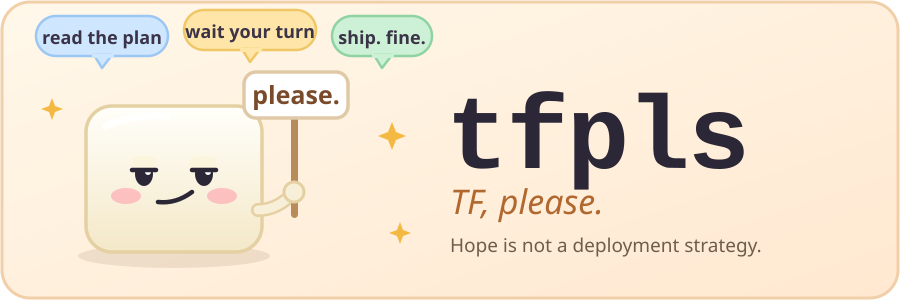

<p align="center">
  
</p>

**Plan on every pull request. Apply with one comment.** Revolutionary, we know: you look at the plan *before* you apply it. tfpls is OpenTofu on GitHub Actions for AWS and S3 state: reusable workflows that run in your repository, on your Actions minutes. Nothing to host, no server of ours in the path.

> 0.x: young, built in spare time, and the interface can change between minor versions (see the [changelog](CHANGELOG.md)). Try it on a throwaway workspace first. Yes, before prod. Especially before prod.

## How it feels

**1. You open a pull request.** Every workspace you touched gets a plan comment, so nobody can claim they did not know (older ones are marked as superseded):

````markdown
**Plan:** 1 to add, 1 to change, 0 to destroy.
### 📝 dev plan logs

> ⚠️ **1 resource(s) will be destroyed or replaced:** `aws_s3_bucket.data` (replace)

<details><summary>Click here to expand</summary> … only what changes, sensitive values hidden … </details>

`/tofu apply dev` to apply
````

**2. A teammate actually reads it.** Then you comment `/tofu apply dev`, and exactly that saved plan is applied. Not a different one. Not "roughly that".

**3. If something is missing, it says no.** Politely, in writing, never a silent skip:

> ⛔ **apply refused.** `dev`: apply needs 1 approving review(s) of the current commit (3f9a1c2); found 0  _(mode `strict`, 1 required)_. The number of approvals comes from the repository's ruleset for `main` (Settings, Rules; 1 when there is none). In an emergency a repository admin can comment `/tofu apply <workspace> --now`.

## Quick start

For a repository with one root module and a folder per workspace (`workspaces/dev`, `workspaces/prod`). `tools/onboard` also handles var-file and `envs/<name>` layouts.

1. **Onboard.** It reads your files and writes `.github/workflows/tofu.yml`, no network:
   ```sh
   curl -fsSL https://raw.githubusercontent.com/denzhel/tfpls/v0/tools/onboard | bash
   ```
   Pass flags as `| bash -s -- --create-workspaces` if the workspaces do not exist in your state yet (first run only).
2. **One IAM role** that GitHub can assume through OIDC (the onboarding prints the trust policy), then:
   ```sh
   gh variable set TFPLS_ROLE_ARN --body arn:aws:iam::<account>:role/<role>
   ```
3. **Encrypt saved plans** (required on public repositories):
   ```sh
   openssl rand -base64 32 | gh secret set PLAN_ENCRYPTION_KEY
   ```
4. **Commit and open ONE pull request.** It plans every workspace. Merge it (nothing is applied); from the next pull request, comment `/tofu apply <workspace>` after a review.

More: [getting started](docs/getting-started.md) (other layouts, secrets instead of OIDC, self-hosted runners). First run going wrong? The [first-run runbook](docs/runbooks.md#first-run) helps.

## What you get

| | |
|---|---|
| 🔍 **Plan** | on every pull request, one comment per workspace, policy checks ([conftest](docs/policies.md)) |
| 🚀 **Apply** | `/tofu apply <workspace>` applies the reviewed plan, or on merge with `auto_apply` |
| 🤝 **Review rules** | approvals of the latest commit by people with write access, optional CODEOWNERS ([approvals](docs/approvals.md)) |
| 🌊 **Drift** | scheduled; an issue per drifted workspace, fixable by comment ([drift](docs/drift.md)) |
| 🔒 **Locks** | see who holds a state lock and release the ones you name ([locks](docs/locks.md)) |
| 🚦 **Queue, ordering** | optional first-come-first-served queue and `after:` ordering ([queue](docs/queue.md), [ordering](docs/ordering.md)) |
| 📒 **Records** | audit log, dashboard, Slack/Teams/webhook messages ([audit](docs/audit.md), [dashboard](docs/dashboard.md), [notifications](docs/notifications.md)) |

Every setting and input: [reference](docs/reference.md). Stuck locks, failed applies, drift: [runbooks](docs/runbooks.md).

## Is it safe?

Short answer: as safe as your cloud credentials. tfpls will not pretend otherwise.

- **The cloud credentials are the only hard boundary.** Plans run the code of the pull request, so anyone who can push a branch runs code with the plan role. Approvals and reviewed plans are process controls on top. For a real boundary, give apply its own role ([credentials](docs/credentials.md)).
- **Approvals and saved plans.** An apply needs the approvals your repository asks for, from people with write access. The saved plan is bound to the commit and is single-use; on public repositories it is stored encrypted.
- **Public repositories** show comments and logs to everyone. Fork pull requests are never planned and get no credentials. Never use self-hosted runners there.
- **Supply chain.** Third-party actions are pinned by SHA and tools are verified by checksum. `@v0` moves with each release; pin an exact tag to fix it.

The full picture: [security model](docs/security-model.md). Found a vulnerability? [SECURITY.md](SECURITY.md).

## Good to know

- AWS and S3 state with `use_lockfile` are what is supported and tested; other backends are in [backends](docs/backends.md).
- Everything is billed to your own Actions minutes ([runner minutes](docs/runner-minutes.md)).
- Without `queue: true` GitHub keeps one pending run per workspace, so a third concurrent run is cancelled ([details](docs/reference.md#concurrency-what-happens-when-several-things-hit-one-workspace)).
- A matrix holds at most 256 workspaces per run.

## Contribute

Pull requests are welcome (yes, even the ones that fix our typos) ([contributing](CONTRIBUTING.md), sign-off under the DCO; [releasing](docs/releasing.md)).

```sh
bash tests/run-all.sh      # offline tests
actionlint
shellcheck -S warning actions/*/*.sh tools/* tests/*.sh
```

Source-available under [FSL-1.1-ALv2](LICENSE): use, modify and contribute freely, no competing product or service, and each release becomes Apache-2.0 after two years.

<p align="center"><sub>Made with care, a little tofu, and zero tolerance for "it worked on my machine". 🙏</sub></p>
