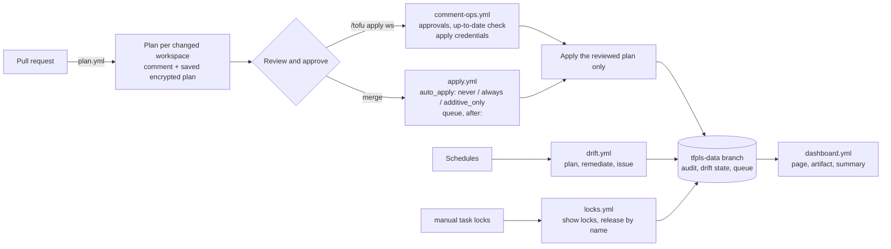

# tfpls documentation

Start with [getting started](getting-started.md), keep the [runbooks](runbooks.md) at hand, read the [security model](security-model.md) before you give the workflows credentials.

| I want to… | Read |
|---|---|
| set up a repository from nothing | [getting-started.md](getting-started.md) |
| understand how a change travels from PR to apply | [flow](#the-flow) below, [reviewed-plans.md](reviewed-plans.md) |
| know what runs with which credentials | [security-model.md](security-model.md), [credentials.md](credentials.md) |
| move from a hand-run `tofu` workflow | [migration.md](migration.md) |
| fix something that is stuck or broken | [runbooks.md](runbooks.md) |
| budget runner minutes | [runner-minutes.md](runner-minutes.md) |
| pick a state backend | [backends.md](backends.md) |
| run my own runners | [runners.md](runners.md) |
| release a new version | [releasing.md](releasing.md) |

Features, one page each: [policies](policies.md) · [audit log](audit.md) · [dashboard](dashboard.md) · [drift](drift.md) · [state locks](locks.md) · [queue](queue.md) · [apply ordering and staged rollouts](ordering.md) · rollback hints (in the [runbooks](runbooks.md)) · [approvals and CODEOWNERS](approvals.md) · [notifications](notifications.md).

## The flow

A change is planned once, on the pull request. The saved plan is bound to the head commit and is the only thing `/tofu apply` or the merge applies; if the state or the code changed in between, the apply refuses (or re-plans under `auto_apply`) instead of applying something nobody reviewed.
