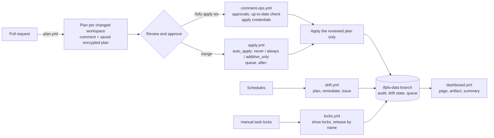

# tfpls documentation

Start with [getting started](getting-started.md), keep the [runbooks](runbooks.md) at hand, read the [security model](security-model.md) before you give the workflows credentials.

| I want to… | Read |
|---|---|
| set up a repository from nothing | [getting-started.md](getting-started.md) |
| look up a setting, an input or a `/tofu` command | [reference.md](reference.md) |
| understand how a change travels from PR to apply | [flow](#the-flow) below, [reviewed-plans.md](reviewed-plans.md) |
| know what runs with which credentials | [security-model.md](security-model.md), [credentials.md](credentials.md) |
| know which security scanners run, and what is AI in them | [automated scanning](security-model.md#automated-scanning) |
| move from a hand-run `tofu` workflow | [migration.md](migration.md) |
| fix something that is stuck or broken | [runbooks.md](runbooks.md) |
| budget runner minutes | [runner-minutes.md](runner-minutes.md) |
| pick a state backend | [backends.md](backends.md) |
| run my own runners | [runners.md](runners.md) |
| release a new version | [releasing.md](releasing.md) |

## What you get

| | |
|---|---|
| 🔍 **Plan** | on every pull request, one comment per workspace, policy checks ([conftest](policies.md)) |
| 🚀 **Apply** | `/tofu apply <workspace>` applies the reviewed plan ([reviewed plans](reviewed-plans.md)), or on merge with `auto_apply` |
| 🤝 **Review rules** | the approvals your ruleset asks for (one of the current commit when there is none), from people with write access; CODEOWNERS when the ruleset requires them ([approvals](approvals.md)) |
| 🌊 **Drift** | scheduled; an issue per drifted workspace, fixable by comment ([drift](drift.md)) |
| 🔒 **Locks** | see who holds a state lock and release the ones you name ([locks](locks.md)) |
| 🚦 **Queue, ordering** | optional first-come-first-served queue, `after:` ordering and staged rollouts ([queue](queue.md), [ordering](ordering.md)) |
| 📒 **Records** | audit log, dashboard, Slack/Teams/webhook messages ([audit](audit.md), [dashboard](dashboard.md), [notifications](notifications.md)) |
| 🩹 **Failed applies** | the comment lists what was already changed and the ways back: fix forward or revert ([rollback hints](runbooks.md#an-apply-failed-half-way)) |

## Good to know

- AWS and S3 state with `use_lockfile` are what is supported and tested; other backends are in [backends](backends.md).
- Everything is billed to your own Actions minutes on GitHub-hosted runners ([runner minutes](runner-minutes.md)).
- Without `queue: true` GitHub keeps one pending run per workspace, so a third concurrent run is cancelled ([details](reference.md#concurrency-what-happens-when-several-things-hit-one-workspace)).
- A matrix holds at most 256 workspaces per run; a change that selects more fails early and says so ([reference](reference.md#workflow-inputs)).
- Third-party actions are pinned by SHA and tools are verified by checksum. `@v0` moves with each release; pin an exact tag to fix it ([releasing](releasing.md)).

## The flow

A change is planned once, on the pull request. The saved plan is bound to the head commit and is the only thing `/tofu apply` or the merge applies; if the state or the code changed in between, the apply refuses (or re-plans under `auto_apply`) instead of applying something nobody reviewed.
